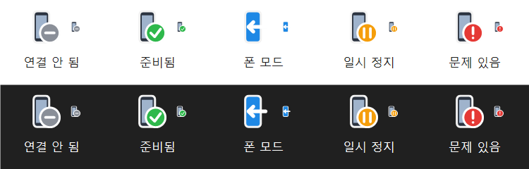
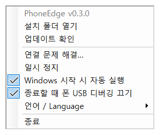
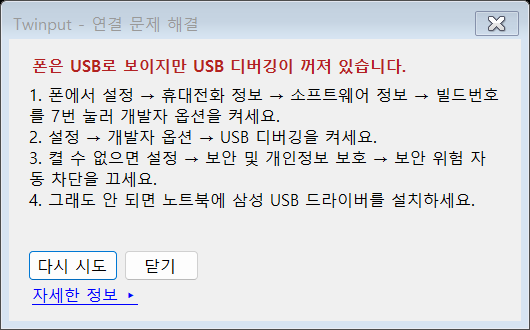
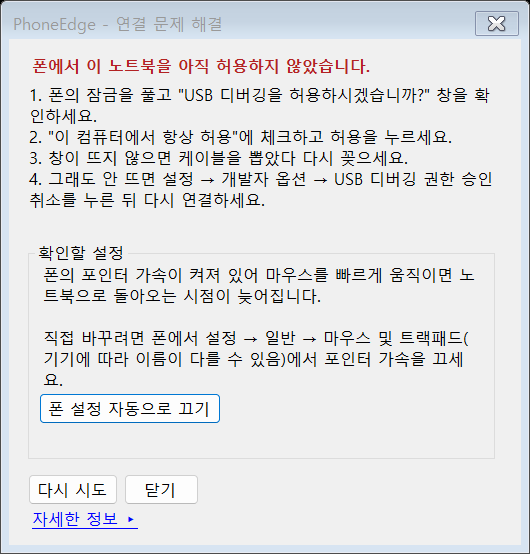
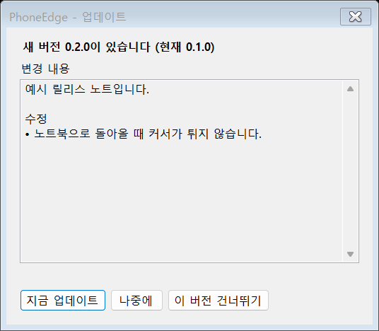

# PhoneEdge

[English](README.md) | **한국어**

노트북 마우스 커서를 화면 오른쪽 끝 밖으로 계속 밀면, 옆에 놓은 USB 연결 안드로이드 폰을 같은 마우스와 키보드로 쓸 수 있습니다. 폰 화면의 왼쪽 끝 밖으로 밀면 노트북으로 돌아옵니다. 폰에는 아무것도 설치하지 않습니다.


*기준 기기: 삼성 갤럭시 Z 폴드7. 앱은 한국어와 영어를 지원하며, 이 문서의 화면은 한국어 UI입니다 (영어 화면은 [README.md](README.md)).*

## 동작 원리


- 앱은 Raw Input과 저수준 훅으로 마우스를 감시합니다. **노트북 모드**에서는 아무것도 달라지지 않습니다. 커서를 가장 오른쪽 모니터의 오른쪽 끝 밖으로 밀고 폰이 준비되어 있으면 **폰 모드**로 바뀌어, 입력이 Windows로 가지 않고 폰으로 갑니다.
- 입력은 USB 케이블을 통해 `adb`로 [scrcpy](https://github.com/Genymobile/scrcpy) 서버(제어 프로토콜만 사용하고 화면 미러링은 하지 않음)에 전달됩니다. 서버가 UHID로 가상 마우스와 키보드를 만들기 때문에 안드로이드는 실제 장치로 인식합니다.
- 앱은 폰 커서의 위치를 추적합니다. 폰 화면의 왼쪽 끝을 넘으면 같은 높이로 노트북에 돌아옵니다.

## 설치

1. [최신 릴리스](https://github.com/ssicci/phone-edge/releases/latest)에서 `PhoneEdge-win-Setup.exe`를 받아 실행합니다. 관리자 권한은 필요 없고, .NET을 따로 설치하지 않아도 됩니다.
2. 설치가 끝나면 시작 메뉴의 PhoneEdge로 실행합니다. 트레이(작업 표시줄 오른쪽 아래)에 폰 모양 아이콘이 나타납니다.

> **SmartScreen 경고**: 설치 파일에 코드 서명이 없어서 "Windows의 PC 보호" 창이 뜰 수 있습니다. **추가 정보 → 실행**을 누르면 설치됩니다.

Windows 10(버전 2004) 이상 64비트가 필요합니다.

**설치 위치:** `%LocalAppData%\PhoneEdge` (예: `C:\Users\<사용자>\AppData\Local\PhoneEdge`). 관리자 권한은 필요 없습니다. **시작 메뉴**에 PhoneEdge 항목이 생기고, 트레이 메뉴의 **설치 폴더 열기**로 설치 폴더를 탐색기에서 열 수 있습니다. 앱의 로그와 설정(`settings.json`)도 같은 폴더에 있습니다.

**제거:** **설정 → 앱 → 설치된 앱**에서 PhoneEdge를 찾아 **제거**를 누릅니다. 시작 메뉴 항목과 "Windows 시작 시 자동 실행" 등록도 함께 지워집니다.

## 폰 처음 설정

1. **설정 → 휴대전화 정보 → 소프트웨어 정보**에서 **빌드번호**를 7번 눌러 개발자 옵션을 켭니다.
2. **설정 → 개발자 옵션**에서 **USB 디버깅**을 켭니다. 켤 수 없으면 **설정 → 보안 및 개인정보 보호 → 보안 위험 자동 차단**에서 **USB 케이블 명령 차단**을 끕니다 (One UI 버전에 따라 메뉴 이름이 다를 수 있음).
3. 데이터 전송이 되는 USB 케이블로 폰을 연결하고, 폰에 "USB 디버깅을 허용하시겠습니까?"가 뜨면 **이 컴퓨터에서 항상 허용**을 체크하고 **허용**을 누릅니다.
4. *(권장)* 폰의 **포인터 가속**을 끕니다. 켜져 있으면 마우스를 빠르게 움직일 때 노트북으로 돌아오는 시점이 늦어집니다. 앱이 이를 위한 버튼을 제공하며(아래 참고), 직접 하려면 폰의 마우스 설정(예: **설정 → 일반 → 마우스 및 트랙패드**, 기기에 따라 이름이 다를 수 있음)에서 끕니다.

## 사용법

- 트레이 아이콘에 초록 체크가 보이면 폰이 준비된 것입니다. 커서를 가장 오른쪽 모니터의 오른쪽 끝 밖으로 밀면 **폰 모드**(파란 화살표 아이콘)가 됩니다.
- 폰 커서를 폰 화면의 왼쪽 끝 밖으로 밀면 노트북으로 돌아옵니다. 노트북 커서는 같은 높이에 다시 나타납니다.
- **`Ctrl+Alt+Esc`**: 어디서든 즉시 노트북으로 돌아옵니다. 폰 케이블을 뽑아도 자동으로 돌아옵니다.
- 폰 모드에서는 마우스 이동, 클릭, 휠, 뒤로/앞으로 버튼과 키보드(한/영, 한자, 오른쪽 Alt/Ctrl, 방향키 포함)가 폰으로 갑니다.

### 트레이 아이콘



| 아이콘 | 의미 |
|---|---|
| 회색, 마이너스 | 연결 안 됨 (폰이 없거나 연결하는 중) |
| 초록 체크 | 준비됨 — 경계를 넘을 수 있음 |
| 파란 화살표 | 폰 모드 — 입력이 폰으로 감 |
| 주황 막대 | 메뉴에서 일시 정지함 |
| 빨간 느낌표 | 연결을 막는 문제가 있음 — 아래 참고 |

### 트레이 메뉴



트레이 아이콘을 오른쪽 클릭하면 버전(빌드 폴더에서 실행하면 "개발 실행" 표시), **설치 폴더 열기**, **업데이트 확인**, **연결 문제 해결…**(문제나 경고가 있을 때만 활성화), **일시 정지**, **Windows 시작 시 자동 실행**, **종료할 때 폰 USB 디버깅 끄기**, **폰 도우미 앱 설치…**(폰이 준비되면 표시), **언어 / Language**, **종료**가 나옵니다.

### Windows 시작 시 자동 실행

PhoneEdge는 직접 켜지 않으면 저절로 시작하지 않습니다. 트레이 메뉴에서 **Windows 시작 시 자동 실행**을 체크하면 로그인할 때 시작하고, 체크를 풀면 멈춥니다. 설치본에서만 동작하며, 개발 실행에서는 비활성화되고 그 이유가 표시됩니다.

설치 프로그램이 만든 실행기(`%LocalAppData%\PhoneEdge\PhoneEdge.exe`)를 `HKCU\Software\Microsoft\Windows\CurrentVersion\Run`에 등록하므로 업데이트 후에도 경로가 그대로 유지됩니다. **설정 → 앱 → 시작 프로그램**(또는 작업 관리자의 시작 앱)에서 PhoneEdge를 끄면 다음에 메뉴를 열 때 체크 표시가 사라지고, 이 항목을 선택하면 다시 켜집니다. 제거하면 등록도 지워집니다.

### 은행·증권 앱과 USB 디버깅

많은 은행·증권 앱은 **USB 디버깅**이 켜져 있으면 실행을 거부하는데, PhoneEdge는 USB 디버깅이 켜져 있어야 동작합니다. 대처하는 방법이 두 가지 있으며, 첫 번째가 자동이고 권장합니다.

#### 폰 도우미 앱 (PhoneEdge Companion, 선택)

**폰이 데이터 케이블로 컴퓨터에 연결되면 USB 디버깅을 켜고, 케이블을 뽑으면 끄는** 작은 선택 안드로이드 앱입니다. 케이블을 뽑는 순간부터 은행 앱이 정상 동작하고, 양쪽에서 따로 할 일이 없습니다.

- **설치:** 폰을 연결하고 초록 체크가 보이면 트레이 메뉴에서 **폰 도우미 앱 설치…**를 선택합니다. PhoneEdge가 확인을 받은 뒤 USB로 앱을 설치하고, 앱이 필요로 하는 권한 하나(USB 디버깅 설정을 바꿀 권한)를 주고, 배터리 최적화에서 제외합니다. 설치가 끝나면 메뉴 항목이 **폰 도우미 앱 설치됨**으로 바뀝니다. PhoneEdge를 업데이트해서 더 새로운 도우미 앱이 들어오면, 다음에 폰을 연결할 때 묻지 않고 폰의 앱도 자동으로 업데이트합니다(폰을 쓰는 중이면 끝날 때까지 기다립니다). 자동 업데이트가 실패하면 메뉴에 **폰 도우미 앱 업데이트…**가 남아 있어 직접 다시 할 수 있습니다.
- **알림:** 앱은 폰에 현재 상태("USB 데이터 연결 · USB 디버깅 켜짐")를 보여 주는 알림을 계속 표시합니다. 상태를 보고 싶다면 이 앱의 알림을 완전히 끄지 마세요.
- **삼성 배터리 설정:** **설정 → 앱 → PhoneEdge Companion → 배터리 → 제한 없음**으로 바꾸고, **설정 → 배터리 → 백그라운드 사용 제한 → 사용하지 않는 앱(절전 앱)** 목록에 들어 있지 않은지 확인하세요. 그렇지 않으면 안드로이드가 앱을 멈출 수 있습니다.
- **보안 모델 요약:** 폰을 다른 컴퓨터에 꽂으면 폰에서 **허용**을 누르기 전까지는 *허가되지 않은* 기기로만 보이므로, USB 디버깅이 켜져도 접근할 수 없습니다. 벽 충전기나 충전 전용 케이블은 USB 디버깅을 켜지 않으며, 앱은 케이블이 빠진 상태에서는 절대 켜지 않습니다. 자세한 내용은 [docs/companion.md](docs/companion.md)를 보세요.

#### 도우미 앱 없이: PhoneEdge를 종료할 때 끄기

기본적으로 PhoneEdge는 **종료할 때 폰의 USB 디버깅을 끕니다** (그 순간 폰이 연결되어 준비된 상태일 때):

- 트레이 메뉴에서 **종료**를 누를 때
- Windows에서 로그오프하거나 종료할 때

업데이트를 적용하려고 다시 시작할 때(바로 다시 연결해야 하므로), 앱이 오류로 끝날 때, 개발 실행에서는 끄지 않습니다. 폰이 준비되어 있지 않으면(예: 케이블을 이미 뽑은 뒤) 할 수 있는 일이 없습니다.

**도우미 앱이 없으면 케이블을 뽑는 것만으로는 USB 디버깅이 꺼지지 않습니다.** USB 디버깅은 폰 안의 설정이라, 케이블이 빠지면 PC가 명령을 보낼 방법이 없습니다. 그러니 PhoneEdge를 먼저 종료하고(또는 다 쓸 때까지 켜 둔 채로) 케이블을 뽑으세요. 도우미 앱을 설치했다면 케이블만 뽑아도 됩니다.

PhoneEdge를 다시 쓰려면 폰의 **개발자 옵션**에서 **USB 디버깅**을 다시 켜고, 폰이 물으면 이 컴퓨터를 허용하세요. 계속 켜 두고 싶다면 트레이 메뉴의 **종료할 때 폰 USB 디버깅 끄기** 체크를 풀면 됩니다. 선택은 저장됩니다.

### 언어

PhoneEdge는 한국어와 영어를 지원합니다. 기본값은 Windows 표시 언어를 따릅니다 (Windows가 한국어면 한국어, 그 외는 영어). 직접 고르려면 트레이 메뉴의 **언어 / Language**에서 **자동**, **한국어**, **English** 중 하나를 선택합니다. 선택은 저장되며 트레이 메뉴, 툴팁, 열려 있는 창에 바로 적용됩니다.

## 연결 문제

폰이 몇 초 동안 연결되지 않으면 PhoneEdge가 원인을 Windows 알림으로 알려 줍니다 (같은 문제는 연결 시도 한 번에 한 번씩). 알림을 누르거나, 트레이 아이콘을 더블클릭하거나, **연결 문제 해결…**을 선택하면 안내 창이 열립니다. 창은 상황이 바뀌는 대로 스스로 갱신되고, 폰이 준비되면 "연결되었습니다"를 보여 줍니다.



*"폰은 USB로 보이지만 USB 디버깅이 꺼져 있습니다" — 창에 해결 단계가 나오고, **다시 시도**는 다시 연결을 시도합니다. **자세한 정보**에서는 원문 출력을 보고 로그 파일을 열 수 있습니다.*



*같은 창에 포인터 가속 경고가 함께 나올 수 있습니다. **폰 설정 자동으로 끄기**를 누르면 앱이 대신 꺼 주고, 직접 바꾸는 방법도 함께 안내합니다.*

| 문제 | 원인 | 해결 |
|---|---|---|
| 기기 없음 | 폰이 연결되지 않았거나 충전 전용 케이블 | 케이블을 다시 꽂기, 데이터 케이블 사용, 다른 USB 포트 사용 |
| USB 디버깅 꺼짐 | USB로는 보이지만 adb에는 안 보임 | USB 디버깅 켜기(위 참고), 켤 수 없으면 보안 위험 자동 차단의 USB 케이블 차단 끄기, 그래도 안 되면 삼성 USB 드라이버 설치 |
| 허용 안 됨 | 폰에서 이 노트북을 아직 허용하지 않음 | 폰 잠금을 풀고 **허용**(항상 허용 체크), 창이 안 뜨면 케이블 재연결 또는 개발자 옵션의 **USB 디버깅 권한 승인 취소** 후 다시 연결 |
| 오프라인 | 연결이 불안정함 | 케이블 재연결, 폰 잠금 해제 |
| 여러 대 연결됨 | 안드로이드 기기가 둘 이상 연결됨 | 사용할 폰 하나만 연결 |
| adb 실패 | 다른 프로그램의 adb와 충돌하거나 보안 프로그램이 차단 | 다시 시도, Android Studio·Smart Switch·다른 scrcpy 종료, 보안 프로그램이 `adb.exe`를 차단하는지 확인 |
| 입력 서비스 실패 | 폰 안의 입력 서비스를 시작하지 못함 | 다시 시도, 보안 위험 자동 차단이 꺼져 있는지 확인, 폰 재시작 후 다시 연결 |

## 업데이트

PhoneEdge는 시작 10초 뒤와 이후 6시간마다 GitHub에서 새 릴리스를 확인합니다 (폰 모드 중에는 확인하지 않음). 트레이 메뉴의 **업데이트 확인**으로 직접 확인할 수도 있습니다. 정식 릴리스만 대상이며 프리릴리스는 제외됩니다.



*예시 버전과 변경 내용입니다. **지금 업데이트**를 누르면 내려받고 진행률을 보여 준 뒤 앱을 다시 시작합니다. **나중에**는 창만 닫습니다. **이 버전 건너뛰기**는 이 버전을 자동 확인에서 숨기며, 메뉴의 **업데이트 확인**에서는 계속 보입니다. 변경 내용은 현재 언어 부분만 보여 주고, 두 언어로 쓰이지 않은 노트는 있는 그대로 보여 줍니다.*

업데이트를 적용하려고 다시 시작하기 전에 앱은 폰 모드를 끝내고 입력 훅을 해제합니다. 내려받기가 실패하면 현재 버전으로 계속 동작합니다.

## 제약 사항

- 아직은 USB 케이블만 지원합니다 (무선은 별도 연결 방식으로 계획 중). 한 번에 폰 한 대만 씁니다.
- 갤럭시 Z 폴드7에서만 시험했습니다. 연결한 채 폰을 접거나 펴는 경우는 측정하지 않았습니다.
- 폰이 노트북의 **오른쪽**에 있다고 가정합니다. 경계 전환은 가장 오른쪽 모니터에서만 일어납니다.
- 폰 모드는 마우스의 Raw Input을 씁니다. 정밀 터치패드는 이런 방식으로 이동을 보고하지 않을 수 있으니 외장 마우스를 쓰세요.
- 설치 파일에 코드 서명이 없습니다 (SmartScreen 경고). Windows 알림은 Windows 10 2004 이상이 필요합니다.
- 앱이 폰의 설정을 대신하지는 않습니다. 정확하게 돌아오려면 포인터 가속을 꺼 두는 것이 좋습니다.

## 개발

```powershell
pwsh tools/fetch-tools.ps1                                   # adb와 scrcpy 서버 받기 (해시 검증)
dotnet build src/PhoneEdge.App/PhoneEdge.App.csproj
dotnet test tests/PhoneEdge.App.Tests/PhoneEdge.App.Tests.csproj
src/PhoneEdge.App/bin/Debug/net8.0-windows10.0.19041.0/PhoneEdge.exe --fake   # 가짜 폰으로 실행 (기기 불필요)
```

- 용어는 [CONTEXT.md](CONTEXT.md), 결정 사항과 폴더 소유권은 [CLAUDE.md](CLAUDE.md), 폰 쪽 측정 결과는 [docs/phase0.md](docs/phase0.md)에 있습니다 (개발 문서는 영어로 씁니다).
- 개발 실행(`bin`에서 실행)은 업데이트를 확인하지 않습니다. 로컬에서 업데이트를 시험하려면 `vpk pack`으로 두 버전을 한 폴더에 만든 뒤, 설치본을 실행하기 전에 환경 변수 `PHONEEDGE_UPDATE_SOURCE`에 그 폴더를 지정합니다 (개발자 전용).
- `--fake`로 실행하면 각 연결 문제와 경고를 흉내 내는 "(dev) Simulate problem" 메뉴가 추가됩니다.
- **문구:** 사용자에게 보이는 모든 문구는 `src/PhoneEdge.App/Resources/Strings.resx`(영어, 기본)와 `Strings.ko.resx`(한국어)에 있습니다. 새 문구는 두 파일에 함께 추가하세요. 단위 테스트가 두 파일의 키가 같은지, 빈 값이 없는지, 코드에서 쓰는 키가 모두 있는지 확인합니다.
- **문서 이미지:** `docs/images/en/`과 `docs/images/ko/`의 PNG는 실제 앱 창을 언어마다 따로 그려 `pwsh scripts/make-docs-images.ps1`로 만듭니다 (`PhoneEdge.exe --make-docs` 실행). UI나 문구를 바꾼 뒤에는 다시 실행하세요. SVG 그림(`how-it-works.svg`, `architecture.svg`, 언어별 한 벌씩)은 손으로 그린 파일입니다.

## 릴리스 절차

1. `CHANGELOG.md`의 `## [Unreleased]`에 변경 내용을 모읍니다 (영문 설명, `---` 줄, 한글 설명 순서). 이 내용이 업데이트 창(현재 언어 부분만)과 GitHub 릴리스 노트가 됩니다.
2. `pwsh scripts/release.ps1 X.Y.Z`를 실행합니다. `[Unreleased]`를 `[X.Y.Z] - 날짜`로 바꾸고, `Directory.Build.props`의 버전을 올리고, CHANGELOG 항목을 확인한 뒤, 실행할 git 명령을 출력합니다 (스크립트가 git을 실행하지는 않습니다).
3. 커밋하고 push 한 다음 `vX.Y.Z` 태그를 push 합니다.
4. 태그가 push 되면 `.github/workflows/release.yml`이 도구 받기 → 테스트 → publish → 이전 릴리스 받기(델타용) → `vpk pack` → GitHub 릴리스 업로드까지 합니다. 태그, `Directory.Build.props`, `CHANGELOG.md`가 서로 다르면 실패합니다.

## 제3자 소프트웨어

[THIRD-PARTY-NOTICES.md](THIRD-PARTY-NOTICES.md)를 보세요. scrcpy 서버(Apache-2.0), Android platform-tools(adb), Velopack(MIT), .NET 런타임(MIT)을 사용합니다.
