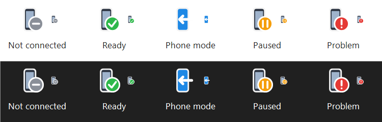
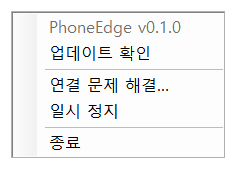
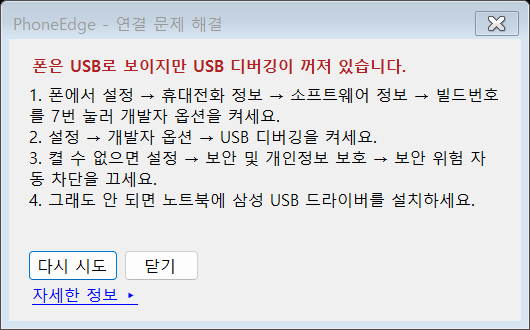
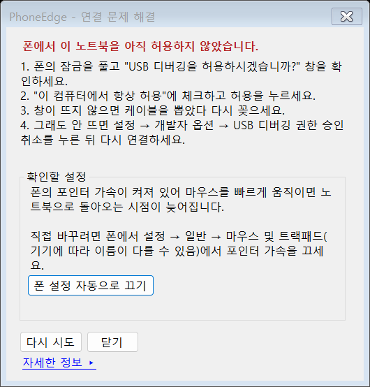
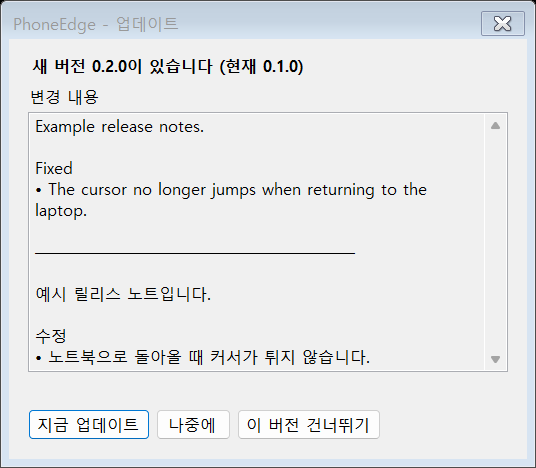

# PhoneEdge

Push your laptop's mouse cursor off the right edge of the screen and keep going — your mouse and keyboard now control the USB-connected Android phone next to it. Push past the phone's left edge to come back. Nothing is installed on the phone.


*Reference device: Samsung Galaxy Z Fold7. The app's windows are in Korean; this document explains them in English.*

## How it works


- The app watches the mouse with Raw Input and low-level hooks. In **laptop mode** nothing changes. When the cursor is pushed past the right edge of the rightmost monitor and the phone is ready, the app switches to **phone mode**: input is no longer given to Windows and is sent to the phone instead.
- The input travels over the USB cable using `adb` to the [scrcpy](https://github.com/Genymobile/scrcpy) server (control protocol only — no screen mirroring). The server creates a virtual mouse and keyboard with UHID, so Android treats them as real hardware.
- The app tracks where the phone cursor is. When it leaves the phone's left edge, input returns to the laptop at the same height.

## Install

1. Download `PhoneEdge-win-Setup.exe` from the [latest release](https://github.com/ssicci/phone-edge/releases/latest) and run it. No administrator rights are needed, and you do not need to install .NET.
2. Start PhoneEdge from the Start menu. A phone-shaped icon appears in the tray (bottom right of the taskbar).

> **SmartScreen warning:** the installer is not code-signed, so Windows may show "Windows protected your PC". Choose **More info → Run anyway**.

Requires Windows 10 (version 2004) or later, 64-bit.

## First-time phone setup

1. Open **Settings → About phone → Software information** and tap **Build number** 7 times to enable Developer options.
2. Open **Settings → Developer options** and turn on **USB debugging**. If it cannot be turned on, go to **Settings → Security and privacy → Auto Blocker** and turn off **Block commands by USB cable** (the menu names may differ by One UI version).
3. Connect the phone with a USB cable that can transfer data. On the phone, choose **Always allow from this computer** and tap **Allow** when asked "Allow USB debugging?".
4. *(Recommended)* Turn off the phone's **pointer acceleration**. With it on, fast mouse movements make the return to the laptop late. The app offers a button for this (see below), or turn it off in the phone's mouse settings (for example **Settings → General management → Mouse and trackpad**; the name may differ).

## Using it

- When the tray icon shows the green check, the phone is ready. Push the cursor past the right edge of your rightmost monitor to enter **phone mode** (blue arrow icon).
- Push the phone cursor past the phone's left edge to return to the laptop. The laptop cursor reappears at the same height.
- **`Ctrl+Alt+Esc`** returns to the laptop immediately, from anywhere. Unplugging the phone also returns automatically.
- While in phone mode, mouse movement, clicks, wheel, back/forward buttons and the keyboard (including Hangul/Hanja keys, right Alt/Ctrl and arrow keys) go to the phone.

### Tray icon



| Icon | Meaning |
|---|---|
| Gray, minus | Not connected (no phone, or still connecting) |
| Green check | Ready — you can cross the edge |
| Blue arrow | Phone mode — input goes to the phone |
| Orange bars | Paused from the menu |
| Red exclamation | A problem is stopping the connection — see below |

### Tray menu



Right-click the tray icon: the version (marked "development run" when started from a build folder), **Check for updates**, **Fix connection problem…** (enabled when there is a problem or a warning), **Pause**, and **Exit**.

## Connection problems

If the phone cannot connect for a few seconds, PhoneEdge shows a Windows notification with the cause (once per problem per attempt). Click it, double-click the tray icon, or use **Fix connection problem…** to open the help window. The window updates by itself as the situation changes and says "connected" once the phone is ready.



*"The phone shows up over USB but USB debugging is off" — the window lists the steps to fix it, and **Retry** (다시 시도) tries to connect again. "Details" (자세한 정보) shows the raw output and opens the log file.*



*A pointer acceleration warning can appear in the same window. **Turn off the phone setting automatically** (폰 설정 자동으로 끄기) does it for you; the manual path is shown as well.*

| Problem | Cause | What to do |
|---|---|---|
| No device | No phone is connected, or the cable is charge-only | Replug the cable; use a data cable; try another USB port |
| USB debugging off | The phone is visible over USB but not to adb | Enable USB debugging (see above); if it cannot be enabled, turn off Auto Blocker's USB-cable blocking; install the Samsung USB driver if it still fails |
| Not authorized | The phone has not allowed this laptop yet | Unlock the phone and tap **Allow** (check "Always allow"); if no prompt appears, replug the cable or use **Revoke USB debugging authorizations** in Developer options and reconnect |
| Offline | The connection is unstable | Replug the cable and unlock the phone |
| Multiple devices | More than one Android device is connected | Connect only the phone you want to use |
| adb failed | Another program's adb conflicts, or security software blocks it | Press Retry; close Android Studio, Smart Switch or another scrcpy; check whether security software blocks `adb.exe` |
| Input service failed | The input service on the phone could not start | Press Retry; make sure Auto Blocker is off; restart the phone and reconnect |

## Updates

PhoneEdge checks GitHub for a new release 10 seconds after it starts and every 6 hours (not while you are in phone mode). You can also choose **Check for updates** in the tray menu. Only stable releases are offered, never pre-releases.



*Example version and notes. **Update now** (지금 업데이트) downloads the update, shows progress, then restarts the app. **Later** (나중에) closes the window. **Skip this version** (이 버전 건너뛰기) hides this version from the automatic check; **Check for updates** in the menu still shows it. The release notes are English followed by Korean.*

Before restarting for an update the app leaves phone mode and releases its hooks. If the download fails, the app keeps running the current version.

## Limitations

- USB cable only for now (wireless is planned as a separate link). One phone at a time.
- Tested on the Galaxy Z Fold7 only. Folding and unfolding the phone while connected has not been measured.
- The phone is assumed to be to the **right** of the laptop. Edge crossing happens only on the rightmost monitor.
- Phone mode uses Raw Input from a mouse. Precision touchpads may not report movement this way, so use an external mouse.
- The installer is not code-signed (SmartScreen warning). Windows notifications need Windows 10 2004 or later.
- The app does not replace the phone's own settings: pointer acceleration should be off for accurate returns.

## Development

```powershell
pwsh tools/fetch-tools.ps1                                   # download adb and the scrcpy server (hashes are verified)
dotnet build src/PhoneEdge.App/PhoneEdge.App.csproj
dotnet test tests/PhoneEdge.App.Tests/PhoneEdge.App.Tests.csproj
src/PhoneEdge.App/bin/Debug/net8.0-windows10.0.19041.0/PhoneEdge.exe --fake   # run with a fake phone, no device needed
```

- Terms are in [CONTEXT.md](CONTEXT.md); decisions and folder ownership are in [CLAUDE.md](CLAUDE.md); the phone-side measurements are in [docs/phase0.md](docs/phase0.md).
- A development run (from `bin`) does not check for updates. To test updating locally, build two versions with `vpk pack` into one folder and set the environment variable `PHONEEDGE_UPDATE_SOURCE` to that folder before starting the installed app (developers only).
- `--fake` adds a "(개발) 문제 흉내" menu that simulates each connection problem and warning.
- **Documentation images:** the PNGs in `docs/images/` are generated from the real app windows with `pwsh scripts/make-docs-images.ps1` (it runs `PhoneEdge.exe --make-docs`). Run it again after changing the UI. The two SVG diagrams are hand-written. The images contain only app windows and example data, never a real desktop or phone screen.

## Releasing

1. Add a `## [X.Y.Z] - date` entry to `CHANGELOG.md`: English notes, a `---` line, then the Korean notes. This text becomes the update window and the GitHub release notes.
2. Run `pwsh scripts/release.ps1 X.Y.Z`. It bumps the version in `Directory.Build.props`, checks the changelog entry, and prints the git commands to run (it does not run git itself).
3. Commit and push, then push the tag `vX.Y.Z`.
4. `.github/workflows/release.yml` then fetches the tools, runs the tests, publishes, downloads the previous release (for delta updates), runs `vpk pack`, and uploads the GitHub release. It fails if the tag, `Directory.Build.props` and `CHANGELOG.md` disagree.

## Third-party software

See [THIRD-PARTY-NOTICES.md](THIRD-PARTY-NOTICES.md): scrcpy server (Apache-2.0), Android platform-tools (adb), Velopack (MIT), .NET runtime (MIT).
