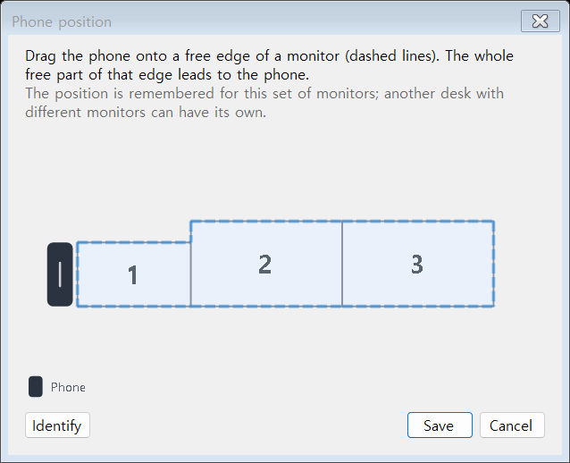
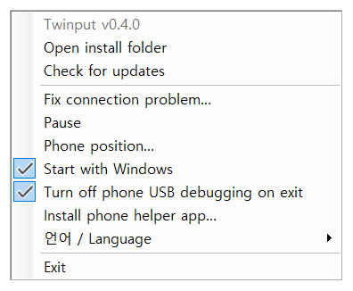
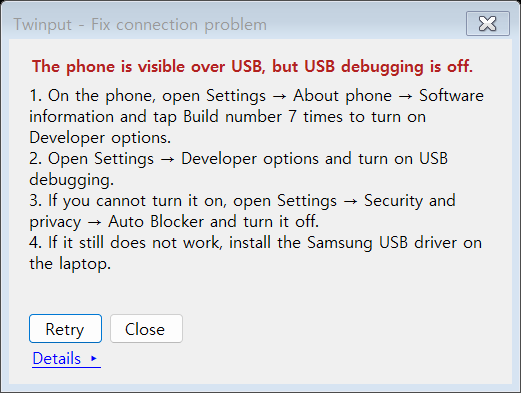
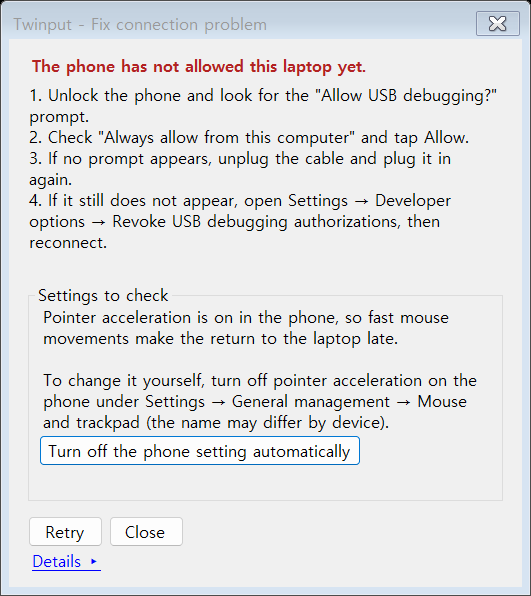
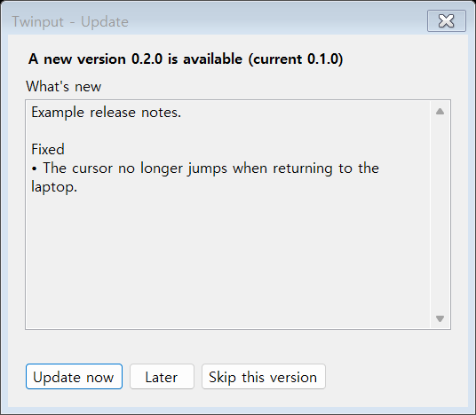

# Twinput

**English** | [한국어](README.ko.md)

Push your laptop's mouse cursor off the edge of the screen next to the phone (the right edge by default) and keep going — your mouse and keyboard now control the USB-connected Android phone. Push past the phone's matching edge to come back. Nothing is installed on the phone.


*Reference device: Samsung Galaxy Z Fold7. The app is available in English and Korean; the screenshots here show the English UI (the Korean ones are in [README.ko.md](README.ko.md)).*

## How it works


- The app watches the mouse with Raw Input and low-level hooks. In **laptop mode** nothing changes. When the cursor is pushed past the **phone slot** (by default the right edge of the rightmost monitor) and the phone is ready, the app switches to **phone mode**: input is no longer given to Windows and is sent to the phone instead.
- The input travels over the USB cable using `adb` to the [scrcpy](https://github.com/Genymobile/scrcpy) server (control protocol only — no screen mirroring). The server creates a virtual mouse and keyboard with UHID, so Android treats them as real hardware.
- The app tracks where the phone cursor is. When it leaves the phone's edge that faces the laptop, input returns to the laptop at the same position.

## Install

1. Download `Twinput-win-x64-Setup.exe` from the [latest release](https://github.com/ssicci/twinput/releases/latest) and run it. No administrator rights are needed, and you do not need to install .NET.
2. Start Twinput from the Start menu. A phone-shaped icon appears in the tray (bottom right of the taskbar).

> **SmartScreen warning:** the installer is not code-signed, so Windows may show "Windows protected your PC". Choose **More info → Run anyway**.

Requires Windows 10 (version 2004) or later, 64-bit.

**Where it is installed:** `%LocalAppData%\Twinput` (for example `C:\Users\<you>\AppData\Local\Twinput`). No administrator rights are needed. The **Start menu** has a Twinput entry, and the tray menu's **Open install folder** opens the install folder in File Explorer. The app's log and settings (`settings.json`) are in the same folder.

**Uninstall:** open **Settings → Apps → Installed apps**, find Twinput and choose **Uninstall**. This also removes the Start menu entry and the "Start with Windows" registration.

**Coming from PhoneEdge?** Twinput is the new name of PhoneEdge. Because the installer id changed, an installed PhoneEdge does not update itself to Twinput; install Twinput once with the setup file above. The first time Twinput starts it copies your settings (language, phone positions, helper-app state, options) from `%LocalAppData%\PhoneEdge`, turns on **Start with Windows** if PhoneEdge had it on (and removes PhoneEdge's entry), and shows a one-time notice. If PhoneEdge is still running it asks you to exit it first, so the two apps do not both capture the mouse and keyboard. Then remove PhoneEdge in **Settings → Apps → Installed apps**; Twinput leaves PhoneEdge's own files alone.

## First-time phone setup

1. Open **Settings → About phone → Software information** and tap **Build number** 7 times to enable Developer options.
2. Open **Settings → Developer options** and turn on **USB debugging**. If it cannot be turned on, go to **Settings → Security and privacy → Auto Blocker** and turn off **Block commands by USB cable** (the menu names may differ by One UI version).
3. Connect the phone with a USB cable that can transfer data. On the phone, choose **Always allow from this computer** and tap **Allow** when asked "Allow USB debugging?".
4. *(Recommended)* Turn off the phone's **pointer acceleration**. With it on, fast mouse movements make the return to the laptop late. The app offers a button for this (see below), or turn it off in the phone's mouse settings (for example **Settings → General management → Mouse and trackpad**; the name may differ).

## Using it

- When the tray icon shows the green check, the phone is ready. Push the cursor past the edge where the phone sits (by default the right edge of your rightmost monitor) to enter **phone mode** (blue arrow icon). Phone elsewhere? See [Phone position](#phone-position).
- Push the phone cursor past the phone's edge that faces the laptop (with the default position, the phone's left edge) to return to the laptop. The laptop cursor reappears at the same relative position, just inside the screen edge.
- **`Ctrl+Alt+Esc`** returns to the laptop immediately, from anywhere. Unplugging the phone also returns automatically.
- While in phone mode, mouse movement, clicks, wheel, back/forward buttons and the keyboard (including Hangul/Hanja keys, right Alt/Ctrl and arrow keys) go to the phone.

### Phone position

By default Twinput assumes the phone is to the right of your rightmost monitor. If it sits somewhere else, choose **Phone position…** in the tray menu:



- The window draws your monitors as numbered boxes. **Drag the phone onto a free edge of a monitor** (the dashed lines); it snaps to the whole free part of that edge. The phone can be on any of the four sides: left, right, above or below.
- An edge, or the part of an edge, that touches another monitor cannot be used, because the cursor passes to that monitor there. When monitors differ in size or position, only the part that no other monitor touches is offered.
- **Identify** shows a big number on every monitor for 2 seconds so you can match the monitors to the picture. **Save** applies the position at once (if you are in phone mode, Twinput returns to the laptop first); **Cancel** keeps the old one.
- The position is remembered **per set of monitors**. Take the laptop to another desk (different monitors, or the same ones arranged differently) and it gets its own position; back at the first desk, the first one comes back by itself. Monitors are told apart by their own identity (model and serial number as the monitor reports them), so changing the resolution or the port does not matter.
- The first time Twinput sees a new set of monitors it starts with the default (the right edge of the rightmost monitor) and shows a notification asking you to set the position; click it to open the window. If Windows notifications are off, the window opens by itself instead.
- If you set the phone to the left or right in 0.6, that choice is carried over to your current monitors automatically.
- With the phone above or below, the cursor goes off the top or bottom edge and appears at the phone's edge that faces the laptop; the position along the edge is kept.

#### Avoiding accidental entry

So that ordinary mouse use near a screen edge does not switch to phone mode by mistake:

- **The ends of the phone slot are skipped** (10% at each end of the edge). That keeps the window close and minimize buttons, the Start button and the taskbar corners working.
- **You have to keep pushing:** after the cursor reaches the edge, push about another 120 mouse counts in the same direction (about 3 mm of mouse travel at 1000 DPI). Moving the other way, or stopping for more than half a second, starts over.
- These values can be changed in `settings.json` (in the install folder). Missing values keep the defaults; out-of-range values are brought into range. Set `PushCounts` and `CornerRatio` to 0 to switch the guard off:

```json
"EntryGuard": { "CornerRatio": 0.1, "PushCounts": 120, "IdleResetMs": 500 }
```

### Tray icon


| Icon | Meaning |
|---|---|
| Gray, minus | Not connected (no phone, or still connecting) |
| Green check | Ready — you can cross the edge |
| Blue arrow | Phone mode — input goes to the phone |
| Orange bars | Paused from the menu |
| Red exclamation | A problem is stopping the connection — see below |

### Tray menu



Right-click the tray icon: the version (marked "development run" when started from a build folder), **Open install folder**, **Check for updates**, **Fix connection problem…** (enabled when there is a problem or a warning), **Pause**, **Phone position…** (where the phone sits), **Start with Windows**, **Turn off phone USB debugging on exit**, **Install phone helper app…** (shown when the phone is ready), **언어 / Language**, and **Exit**.

### Start with Windows

Twinput does not start by itself unless you ask it to. Check **Start with Windows** in the tray menu and it starts when you sign in; uncheck it to stop. The item works only in the installed app (in a development run it is disabled and says so).

It registers the installer's launcher (`%LocalAppData%\Twinput\Twinput.exe`) under `HKCU\Software\Microsoft\Windows\CurrentVersion\Run`, so the path stays valid after updates. If you turn Twinput off in **Settings → Apps → Startup** (or Task Manager's Startup apps), the check mark disappears the next time you open the menu, and choosing the item turns it back on. Uninstalling removes the registration.

### Banking and securities apps (USB debugging)

Many banking and securities apps refuse to run while **USB debugging** is on, and Twinput needs it on. There are two ways to deal with this; the first is automatic and recommended.

#### Phone helper app (Twinput Companion, optional)

A small optional Android app that **turns USB debugging on when the phone is connected to a computer with a data cable, and off when the cable is unplugged** — so banking apps work as soon as you unplug, with nothing to do on either side.

- **Install:** connect the phone, wait for the green check, then choose **Install phone helper app…** in the tray menu. Twinput asks you to confirm, installs the app over USB, gives it the one permission it needs (to change the USB debugging setting) and excludes it from battery optimization. The menu item then shows **Phone helper app installed**. When a Twinput update brings a newer helper app, Twinput updates it on the phone by itself the next time the phone is connected, without asking (it waits while you are using the phone). If that fails, **Update phone helper app…** stays in the menu so you can retry.
- **Notification:** the app keeps one persistent notification on the phone showing the current state ("USB data connection · USB debugging on"). Do not turn notifications for the app off completely if you want to see it.
- **Samsung battery settings:** set **Settings → Apps → Twinput Companion → Battery → Unrestricted**, and make sure the app is not under **Settings → Battery → Background usage limits → Sleeping apps**. Otherwise Android may stop the app.
- **Security model, in short:** another computer you plug the phone into only sees an *unauthorized* device until you tap **Allow** on the phone, so turning USB debugging on does not give it access. A wall charger or a charge-only cable does not turn it on. The app never turns it on while unplugged. Details: [docs/companion.md](docs/companion.md).

#### Without the helper app: turn it off when Twinput exits

By default Twinput **turns USB debugging off on the phone when it exits**, as long as the phone is connected and ready at that moment:

- when you choose **Exit** in the tray menu, and
- when you sign out of or shut down Windows.

It does not do this when the app restarts to install an update (it must reconnect right away), when it crashes, or in a development run. If the phone is not ready (for example the cable is already unplugged) there is nothing it can do.

**Without the helper app, unplugging the cable alone does not turn USB debugging off.** It is a setting inside the phone, and the PC has no way to send a command once the cable is gone — so exit Twinput first (or leave it running until you are done) and then unplug. With the helper app installed, unplugging is enough.

To use Twinput again, turn **USB debugging** back on in the phone's **Developer options** and allow the computer if the phone asks. If you would rather keep it on, uncheck **Turn off phone USB debugging on exit** in the tray menu; the choice is saved.

### Language

Twinput is available in English and Korean. By default it follows the Windows display language (Korean if Windows is set to Korean, English otherwise). To choose a language yourself, open **언어 / Language** in the tray menu and pick **Auto**, **한국어** or **English**. The choice is saved and applies immediately to the tray menu, the tooltip and any open window.

## Connection problems

If the phone cannot connect for a few seconds, Twinput shows a Windows notification with the cause (once per problem per attempt). Click it, double-click the tray icon, or use **Fix connection problem…** to open the help window. The window updates by itself as the situation changes and says "connected" once the phone is ready.



*"The phone is visible over USB, but USB debugging is off" — the window lists the steps to fix it, and **Retry** tries to connect again. **Details** shows the raw output and opens the log file.*



*A pointer acceleration warning can appear in the same window. **Turn off the phone setting automatically** does it for you; the manual path is shown as well.*

| Problem | Cause | What to do |
|---|---|---|
| No device | No phone is connected, or the cable is charge-only | Replug the cable; use a data cable; try another USB port |
| USB debugging off | The phone is visible over USB but not to adb | Enable USB debugging (see above); if it cannot be enabled, turn off Auto Blocker's USB-cable blocking; install the Samsung USB driver if it still fails |
| Not authorized | The phone has not allowed this laptop yet | Unlock the phone and tap **Allow** (check "Always allow"); if no prompt appears, replug the cable or use **Revoke USB debugging authorizations** in Developer options and reconnect |
| Offline | The connection is unstable | Replug the cable and unlock the phone |
| Multiple devices | More than one Android device is connected | Connect only the phone you want to use |
| adb failed | Another program's adb conflicts, or security software blocks it | Press Retry; close Android Studio, Smart Switch or another scrcpy; check whether security software blocks `adb.exe` |
| Input service failed | The input service on the phone could not start | Press Retry; make sure Auto Blocker is off; restart the phone and reconnect |

## Updates

Twinput checks GitHub for a new release 10 seconds after it starts and every 6 hours (not while you are in phone mode). You can also choose **Check for updates** in the tray menu. Only stable releases are offered, never pre-releases.



*Example version and notes. **Update now** downloads the update, shows progress, then restarts the app. **Later** closes the window. **Skip this version** hides this version from the automatic check; **Check for updates** in the menu still shows it. The window shows the release notes in the current language only; notes that are not written in both languages are shown as they are.*

Before restarting for an update the app leaves phone mode and releases its hooks. If the download fails, the app keeps running the current version.

## Limitations

- USB cable only for now (wireless is planned as a separate link). One phone at a time.
- Tested on the Galaxy Z Fold7 only. Folding and unfolding the phone while connected has not been measured.
- The phone can be on any of the four sides of your monitors (**Phone position…**), but only on an edge, or part of an edge, that no other monitor touches, and there is one phone position per set of monitors. Moving the cursor through the phone position only works there; the rest of your screen edges behave as usual.
- Phone mode uses Raw Input from a mouse. Precision touchpads may not report movement this way, so use an external mouse.
- The installer is not code-signed (SmartScreen warning). Windows notifications need Windows 10 2004 or later.
- The app does not replace the phone's own settings: pointer acceleration should be off for accurate returns.

## Development

```powershell
pwsh tools/fetch-tools.ps1                                   # download adb and the scrcpy server (hashes are verified)
dotnet build src/Twinput.App/Twinput.App.csproj
dotnet test tests/Twinput.App.Tests/Twinput.App.Tests.csproj
src/Twinput.App/bin/Debug/net8.0-windows10.0.19041.0/Twinput.exe --fake   # run with a fake phone, no device needed
```

- Terms are in [CONTEXT.md](CONTEXT.md); decisions and folder ownership are in [CLAUDE.md](CLAUDE.md); the phone-side measurements are in [docs/phase0.md](docs/phase0.md).
- A development run (from `bin`) does not check for updates. To test updating locally, build two versions with `vpk pack --channel win-x64` (the channel the app uses, see `UpdateService.Channel`) into one folder and set the environment variable `TWINPUT_UPDATE_SOURCE` to that folder before starting the installed app (developers only).
- `--fake` adds a "(dev) Simulate problem" menu that simulates each connection problem and warning.
- **Texts:** every user-visible string lives in `src/Twinput.App/Resources/Strings.resx` (English, the default) and `Strings.ko.resx` (Korean). Add a new string to both files; a unit test checks that the two have the same keys, no empty values, and that every key used in the code exists.
- **Documentation images:** the PNGs in `docs/images/en/` and `docs/images/ko/` are generated from the real app windows, once per language, with `pwsh scripts/make-docs-images.ps1` (it runs `Twinput.exe --make-docs`). Run it again after changing the UI or any text. The SVG diagrams (`how-it-works.svg`, `architecture.svg`, one copy per language) are hand-written. The images contain only app windows and example data, never a real desktop or phone screen.

## Releasing

1. Collect the changes under `## [Unreleased]` in `CHANGELOG.md` (English notes, a `---` line, then the Korean notes). This text becomes the update window (current language only) and the GitHub release notes.
2. Run `pwsh scripts/release.ps1 X.Y.Z`. It renames `[Unreleased]` to `[X.Y.Z] - date`, bumps the version in `Directory.Build.props`, checks the changelog entry, and prints the git commands to run (it does not run git itself).
3. Commit and push, then push the tag `vX.Y.Z`.
4. `.github/workflows/release.yml` then fetches the tools, runs the tests, publishes, downloads the previous release (for delta updates), runs `vpk pack`, and uploads the GitHub release. It fails if the tag, `Directory.Build.props` and `CHANGELOG.md` disagree.

## Third-party software

See [THIRD-PARTY-NOTICES.md](THIRD-PARTY-NOTICES.md): scrcpy server (Apache-2.0), Android platform-tools (adb), Velopack (MIT), .NET runtime (MIT).
